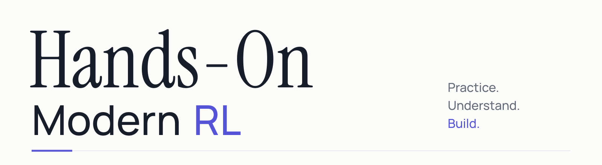
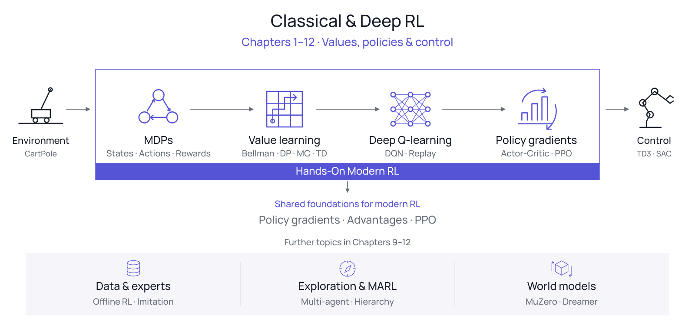
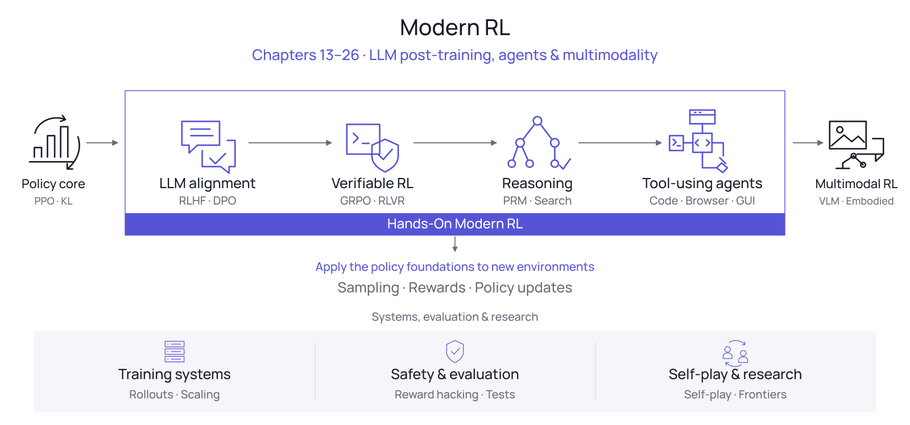
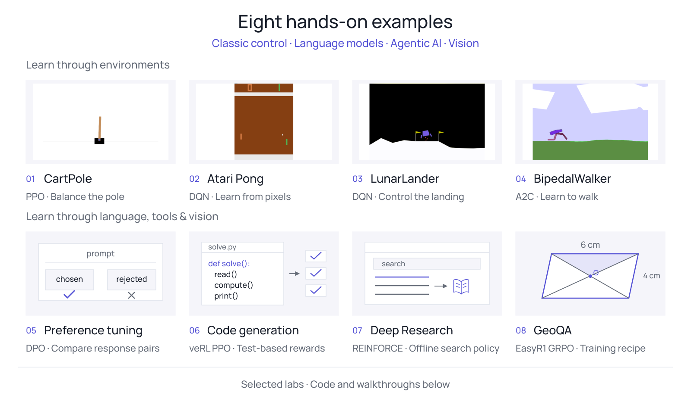
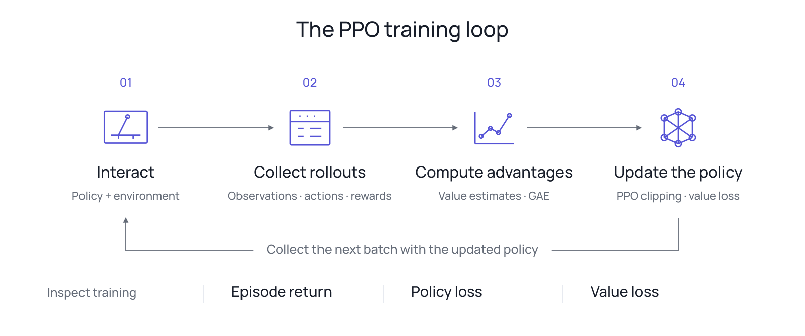

<div align="center">
  <picture>
    <source media="(prefers-color-scheme: dark) and (max-width: 640px)" srcset="docs/public/readme/wordmark-compact-dark.svg" />
    <source media="(max-width: 640px)" srcset="docs/public/readme/wordmark-compact.svg" />
    <source media="(prefers-color-scheme: dark)" srcset="docs/public/readme/wordmark-dark.svg" />
    
  </picture>
  <p><em>從馬可夫決策過程與策略最佳化，到推理模型、代理與多模態系統</em></p>

  <p>
    <a href="https://walkinglabs.github.io/hands-on-modern-rl/"></a>
    <a href="https://github.com/walkinglabs/hands-on-modern-rl/releases/latest"></a>
    <a href="https://github.com/walkinglabs/hands-on-modern-rl/blob/main/LICENSE"></a>
    = 18" />
    
  </p>

  <p>
    <a href="README.md">English</a> ·
    <a href="README.zh.md">中文</a> ·
    <a href="README.zh-TW.md">繁體中文</a>
  </p>

  <p>
    <a href="https://modelscope.cn/studios/walkinglab/hands-on-modern-rl-experiment01-cartpole">在 ModelScope 上訓練</a> ·
    <a href="https://modelscope.cn/notebook/share/github/walkinglabs/hands-on-modern-rl/blob/main/code/online-experiments/hands-on-modern-rl-experiment01-cartpole.ipynb">執行 CartPole Notebook</a> ·
    <a href="https://modelscope.cn/studios/walkinglab/hands-on-modern-rl-experiment01-cartpole/file/view/master/train.py">ModelScope 腳本</a>
  </p>

  <p>
    <a href="#討論群組wechat">討論群組（WeChat）</a>
  </p>

  <p>
    <a href="#學習路徑">學習路徑</a> ·
    <a href="#實作範例">實作範例</a> ·
    <a href="#本書特色">本書特色</a> ·
    <a href="#關於本書">關於本書</a> ·
    <a href="#最新消息">最新消息</a> ·
    <a href="#目錄">目錄</a> ·
    <a href="#本書架構">本書架構</a> ·
    <a href="#實驗程式碼">實驗程式碼</a> ·
    <a href="#快速開始">快速開始</a> ·
    <a href="#參與貢獻">參與貢獻</a>
  </p>
</div>

實驗室現已包含 14 本可獨立執行的章節 Notebook，以及 12 個搭配的 Studio。歡迎瀏覽[實驗室](https://walkinglabs.github.io/hands-on-modern-rl/en/labs/)，或查看[本機執行紀錄](code/chapter-notebooks/README.md).

## 學習路徑

**經典與深度強化學習（第 1–12 章）。** 從 CartPole 出發：選擇一個動作、觀察下一個狀態、取得獎勵。圍繞這個互動建立 MDP 與價值函式，接著在遊戲與控制任務中實作 DQN、策略梯度、Actor-Critic 與 PPO。離線強化學習、模仿學習、探索與世界模型則在這些基礎上進一步延伸。

<!-- README visual: classic-route -->
<p align="center">
  <picture>
    <source media="(prefers-color-scheme: dark) and (max-width: 640px)" srcset="docs/public/readme/classic-route-compact-dark.svg" />
    <source media="(max-width: 640px)" srcset="docs/public/readme/classic-route-compact.svg" />
    <source media="(prefers-color-scheme: dark)" srcset="docs/public/readme/classic-route-dark.svg" />
    
  </picture>
</p>
<!-- /README visual -->

**現代強化學習與代理式 AI（第 13–26 章）。** 透過 RLHF、DPO、GRPO 與可驗證獎勵，將策略的基礎應用到既有的語言模型上。代理式 AI 讓模型從一次性回答，進一步擴展到呼叫工具、瀏覽網頁、撰寫程式與完成多步驟任務；代理式強化學習的章節則利用整條軌跡的回饋來訓練這些決策。後面的章節涵蓋視覺與具身任務、訓練系統與評估。

<!-- README visual: modern-route -->
<p align="center">
  <picture>
    <source media="(prefers-color-scheme: dark) and (max-width: 640px)" srcset="docs/public/readme/modern-route-compact-dark.svg" />
    <source media="(max-width: 640px)" srcset="docs/public/readme/modern-route-compact.svg" />
    <source media="(prefers-color-scheme: dark)" srcset="docs/public/readme/modern-route-dark.svg" />
    
  </picture>
</p>
<!-- /README visual -->

> **📣 公告**
>
> 衷心感謝大家對這份教學的支持！新版本即將推出。許多章節仍在整理與調整中，敬請耐心等候。歡迎隨時提供建議與回饋！

## 最新消息

> **注意：** 本課程在 AI 協助下製作，尚未完整審閱，可能含有事實錯誤，或無法如預期執行的程式碼。非常歡迎提出 Issue 與 Pull Request。

- **[2026-08-19]** 🎮 **線上經典強化學習環境與腳本**：過去兩週，我們新增並改進了一系列線上強化學習環境、訓練腳本與搭配的 Notebook。學習者現在可以在線上執行經典強化學習實驗、查看訓練記錄與評估結果，更方便地研讀各項演算法。我們也修正了許多先前回報的課程內容、連結與實驗程式碼的錯誤。
- **[2026-05-15]** 📖 **完整英文翻譯與 PDF 發行**：所有章節的完整英文翻譯現已推出。中文版與英文版的 PDF 均由 CI 自動建置並發行。
- **[2026-05-13]** 🚀 **重大升級：大型語言模型與傳統強化學習實作實驗**：新增 **代理式強化學習**（Deep Research / rLLM）與 **傳統強化學習**（Actor-Critic 連續控制）的可重現訓練範例。內容包含從零打造代理式訓練系統的完整程式碼與微調分析，以及新的 VLM 強化學習（GeoQA 幾何推理）實作實驗！
- **[2026-05-02]** 首次開源釋出，可供瀏覽，歡迎測試與回饋。

## 實作範例

課程中的八個範例：四個以環境為基礎的實驗，接著是偏好微調、程式碼強化學習、研究代理與視覺推理。以下連結會開啟對應的程式碼或逐步說明；完整的範例集合請見 [`code/README.md`](code/README.md)。

<!-- README visual: lab-gallery -->
<p align="center">
  <picture>
    <source media="(prefers-color-scheme: dark) and (max-width: 640px)" srcset="docs/public/readme/lab-gallery-compact-dark.svg" />
    <source media="(max-width: 640px)" srcset="docs/public/readme/lab-gallery-compact.svg" />
    <source media="(prefers-color-scheme: dark)" srcset="docs/public/readme/lab-gallery-dark.svg" />
    
  </picture>
</p>
<!-- /README visual -->

| 實驗          | 程式碼或逐步說明                                                                                |
| ------------- | ----------------------------------------------------------------------------------------------- |
| CartPole      | [PPO 訓練與環境重播](code/chapter01_cartpole/1-ppo_cartpole.py)                                 |
| Atari Pong    | [以影像觀測進行 DQN 訓練](code/chapter04_dqn/dqn_atari_sb3.py)                                  |
| LunarLander   | [DQN 訓練與著陸評估](code/chapter04_dqn/dqn_gym_sb3.py)                                         |
| BipedalWalker | [用於連續控制的 A2C 訓練](code/chapter06_actor_critic/actor_critic_bipedalwalker.py)            |
| DPO           | [準備偏好資料、微調並測試回應](code/chapter17_dpo/)                                             |
| Code RLVR     | [以可執行 I/O 測試作為獎勵的 veRL PPO](code/chapter18_grpo/verl_code_rlvr/)                     |
| Deep Research | [在小型離線搜尋策略上執行 REINFORCE](docs/chapter22_agentic/code/deep_research_rl_benchmark.py) |
| GeoQA         | [EasyR1 GRPO 資料、獎勵與訓練逐步說明](docs/chapter26_vlm/easyr1-geoqa.md)                      |

## 線上訓練 Notebook

WalkingLab 與 ModelScope 合作，為經典強化學習實驗提供線上訓練環境。ModelScope Studio 將實驗介面、執行環境與訓練入口整合在同一個頁面，學習者無須先設定本機環境，就能直接在瀏覽器中開始訓練並觀察代理。

每個 Studio 在 [`code/online-experiments`](code/online-experiments/README.md) 下都有搭配的 Notebook。Notebook 匯入與 Studio 相同的訓練執行環境，開放實驗參數，印出完整的訓練記錄，繪製各檢查點的評估結果，並顯示學習後策略的重播或結果產出。

| 實驗                        | 資源      | 搭配的 Notebook                                                                                                                                                                        | 線上 Studio                                                                                                |
| --------------------------- | --------- | -------------------------------------------------------------------------------------------------------------------------------------------------------------------------------------- | ---------------------------------------------------------------------------------------------------------- |
| 01 · CartPole PPO           | CPU       | [執行 Notebook](https://modelscope.cn/notebook/share/github/walkinglabs/hands-on-modern-rl/blob/main/code/online-experiments/hands-on-modern-rl-experiment01-cartpole.ipynb)           | [開啟 Studio](https://modelscope.cn/studios/walkinglab/hands-on-modern-rl-experiment01-cartpole)           |
| Gymnasium 遊樂場            | CPU       | [執行 Notebook](https://modelscope.cn/notebook/share/github/walkinglabs/hands-on-modern-rl/blob/main/code/online-experiments/hands-on-modern-rl-experiment-gymnasium.ipynb)            | [開啟 Studio](https://modelscope.cn/studios/walkinglab/hands-on-modern-rl-experiment-gymnasium)            |
| 02 · ViZDoom                | CPU       | [執行 Notebook](https://modelscope.cn/notebook/share/github/walkinglabs/hands-on-modern-rl/blob/main/code/online-experiments/hands-on-modern-rl-experiment02-vizdoom.ipynb)            | [開啟 Studio](https://modelscope.cn/studios/walkinglab/hands-on-modern-rl-experiment02-vizdoom)            |
| 03 · Atari / ALE            | CPU / GPU | [執行 Notebook](https://modelscope.cn/notebook/share/github/walkinglabs/hands-on-modern-rl/blob/main/code/online-experiments/hands-on-modern-rl-experiment03-atari.ipynb)              | [開啟 Studio](https://modelscope.cn/studios/walkinglab/hands-on-modern-rl-experiment03-atari)              |
| 04 · 棋盤遊戲與自我對弈     | CPU       | [執行 Notebook](https://modelscope.cn/notebook/share/github/walkinglabs/hands-on-modern-rl/blob/main/code/online-experiments/hands-on-modern-rl-experiment04-board-selfplay.ipynb)     | [開啟 Studio](https://modelscope.cn/studios/walkinglab/hands-on-modern-rl-experiment04-board-selfplay)     |
| 05 · 多代理遊戲             | CPU       | [執行 Notebook](https://modelscope.cn/notebook/share/github/walkinglabs/hands-on-modern-rl/blob/main/code/online-experiments/hands-on-modern-rl-experiment05-multiagent-games.ipynb)   | [開啟 Studio](https://modelscope.cn/studios/walkinglab/hands-on-modern-rl-experiment05-multiagent-games)   |
| 06 · MiniGrid 冒險          | CPU       | [執行 Notebook](https://modelscope.cn/notebook/share/github/walkinglabs/hands-on-modern-rl/blob/main/code/online-experiments/hands-on-modern-rl-experiment06-minigrid-adventure.ipynb) | [開啟 Studio](https://modelscope.cn/studios/walkinglab/hands-on-modern-rl-experiment06-minigrid-adventure) |
| 07 · JAX MinAtar            | CPU       | [執行 Notebook](https://modelscope.cn/notebook/share/github/walkinglabs/hands-on-modern-rl/blob/main/code/online-experiments/hands-on-modern-rl-experiment07-jax-games.ipynb)          | [開啟 Studio](https://modelscope.cn/studios/walkinglab/hands-on-modern-rl-experiment07-jax-games)          |
| 08 · ManiSkill              | CPU / GPU | [執行 Notebook](https://modelscope.cn/notebook/share/github/walkinglabs/hands-on-modern-rl/blob/main/code/online-experiments/hands-on-modern-rl-experiment08-maniskill.ipynb)          | [開啟 Studio](https://modelscope.cn/studios/walkinglab/hands-on-modern-rl-experiment08-maniskill)          |
| 10 · MineStudio / Minecraft | CPU / GPU | [執行 Notebook](https://modelscope.cn/notebook/share/github/walkinglabs/hands-on-modern-rl/blob/main/code/online-experiments/hands-on-modern-rl-experiment10-minestudio.ipynb)         | [開啟 Studio](https://modelscope.cn/studios/walkinglab/hands-on-modern-rl-experiment10-minestudio)         |
| 11 · Unity ML-Agents        | xGPU      | [執行 Notebook](https://modelscope.cn/notebook/share/github/walkinglabs/hands-on-modern-rl/blob/main/code/online-experiments/hands-on-modern-rl-experiment11-unity-mlagents.ipynb)     | [開啟 Studio](https://modelscope.cn/studios/walkinglab/hands-on-modern-rl-experiment11-unity-mlagents)     |
| 12 · AI2-THOR               | xGPU      | [執行 Notebook](https://modelscope.cn/notebook/share/github/walkinglabs/hands-on-modern-rl/blob/main/code/online-experiments/hands-on-modern-rl-experiment12-ai2thor-embodied.ipynb)   | [開啟 Studio](https://modelscope.cn/studios/walkinglab/hands-on-modern-rl-experiment12-ai2thor-embodied)   |

標示為 CPU 的項目可在一般 Notebook 執行個體上執行。實驗 03、08、10、11 與 12 需要排程使用 ModelScope xGPU Notebook，並會在訓練前檢查 CUDA。

## 本書特色

<table>
  <tr>
    <td width="50%" align="center">
      
      <br />
      <strong>一條連貫的學習路徑</strong>
      <br />
      <sub>從一次 CartPole 試驗開始，逐步學到價值學習、策略最佳化與現代代理。</sub>
    </td>
    <td width="50%" align="center">
      
      <br />
      <strong>公式與程式碼並陳</strong>
      <br />
      <sub>PPO、DPO 與 GRPO 的關鍵推導與其實作並列呈現，每個張量都交代清楚。</sub>
    </td>
  </tr>
  <tr>
    <td width="50%" align="center">
      
      <br />
      <strong>以實驗檢驗論點</strong>
      <br />
      <sub>真實的訓練曲線、消融實驗與失敗訊號，說明演算法何時有效、何時無效。</sub>
    </td>
    <td width="50%" align="center">
      
      <br />
      <strong>從經典強化學習到語言模型</strong>
      <br />
      <sub>策略梯度與 PPO 自然延伸到 RLHF、DPO、GRPO 與 RLVR。</sub>
    </td>
  </tr>
  <tr>
    <td width="50%" align="center">
      
      <br />
      <strong>將代理視為循序決策</strong>
      <br />
      <sub>工具使用、瀏覽器互動與程式碼修復，都成為狀態、動作、軌跡與信用分配的問題。</sub>
    </td>
    <td width="50%" align="center">
      
      <br />
      <strong>先見現象，再談抽象</strong>
      <br />
      <sub>CartPole、LunarLander、Atari 與大型語言模型實驗先提出問題，再引入數學。</sub>
    </td>
  </tr>
</table>

---

> [!NOTE]
> 我們希望這門開放課程能讓更多學習者有勇氣攀向智慧的前沿，解決通往 AGI 路上更多的難題。
>
> 課程快速演進中。建議優先閱讀未標示為施工中的章節；仍在進行中的章節可能含有錯誤，歡迎指正或提出建議。

> **徵求協助**
>
> 由於運算資源有限，我們正在尋求 GPU 支援。若您能協助提供 GPU，請聯絡 physicoada@gmail.com.

## 目錄

- [本書特色](#本書特色)
- [關於本書](#關於本書)
- [本書架構](#本書架構)
- [實驗程式碼](#實驗程式碼)
- [建議學習路徑](#建議學習路徑)
- [快速開始](#快速開始)
- [參與貢獻](#參與貢獻)
- [引用](#引用)
- [致謝](#致謝)
- [授權](#授權)

## 關於本書

強化學習研究一個看似簡單、實則困難的問題：系統採取行動、觀察後果，並利用這些後果改進下一次的行動。當獎勵姍姍來遲、觀測並不完整，而且每次更新都會改變未來經驗的分佈時，我們熟悉的「輸入與標籤」監督式學習模型便不再足夠。我們需要一套描述互動的語言、一種估計長期回報的方法，以及能從有限資料中穩定改進策略的方法。

**Hands-On Modern RL** 從頭到尾追隨這個問題。首先以 CartPole 與多臂老虎機（multi-armed bandit）讓狀態、動作、獎勵與策略變得可觀察。接著由馬可夫決策過程、價值函式與貝爾曼方程式提供共通的語言。在此基礎上，本書逐步發展 DQN、策略梯度、actor-critic 方法、PPO、連續控制與離線強化學習。有了這些基礎，RLHF、DPO、GRPO 與 RLVR 就成為同一套循序決策框架的延伸，而不再是一堆各自孤立的縮寫。

後半部將環境擴展到工具、瀏覽器、程式碼儲存庫、視覺與音訊。一個動作可能是一段文字、一次函式呼叫，或一連串介面操作；獎勵可能來自人類偏好、規則式驗證器，或過程獎勵模型。情境雖然改變，但有三個問題貫穿全書：**該如何表示決策過程？如何把結果歸功於先前的動作？又如何判斷策略是否真的進步了？**

### 教學方式

每一章都依循「問題、方法、實驗、反思」的節奏。先以具體任務揭示困難，接著介紹解決問題所需的概念與公式，再以可執行的程式碼、訓練曲線與評估指標檢驗論述，最後檢視各項假設、失敗模式與方法的限制。數學用來解釋觀察到的行為，實驗則用來檢驗數學。

實作保留每個演算法清楚可見的骨架。讀者可以追蹤軌跡蒐集、優勢估計、損失函數建構與指標變化，並看到獎勵駭客（reward hacking）、KL 漂移、熵崩塌、分佈偏移或評估洩漏，如何讓一次看似成功的訓練失效。

### 適合讀者

本書適合具備基本機器學習經驗，並希望系統性理解現代強化學習的學生、研究人員與工程師。讀者應熟悉 Python 與基礎的 PyTorch，並具備入門程度的線性代數、機率與微積分。數學附錄會把這些工具重新建構到各章所需的深度，因此不需要另外修習進階數學課程。

完成核心章節與實驗後，你應該能夠：

- 以 MDP、價值函式、貝爾曼方程式與信用分配來描述新的決策問題；
- 實作、閱讀並診斷 DQN、REINFORCE、actor-critic 方法、PPO、DPO 與 GRPO；
- 說明 SFT、獎勵建模、偏好最佳化、RLHF 與 RLVR 在大型語言模型後訓練中如何相互配合；
- 為工具使用、程式碼與多模態代理設計軌跡、獎勵、訓練迴圈與評估流程；
- 從訓練曲線找出背後的失敗模式，並以對照實驗檢驗所提出的改進。

### 目前狀態

本儲存庫是一個持續進行中的課程教材專案。內容正逐章擴充，重點在於正確性、可執行的範例與穩定的學習路徑。

- 課程網站：[walkinglabs.github.io/hands-on-modern-rl](https://walkinglabs.github.io/hands-on-modern-rl/)
- 原始內容：[`docs/`](docs/)
- 可執行範例：[`code/`](code/)
- 本機驗證：`npm run verify`
- 授權：[CC BY-NC-SA 4.0](LICENSE)

歡迎針對錯字修正、概念更正、可重現性改進、參考資料與聚焦的課程擴充，提出 Issue 與 Pull Request。

## 發展藍圖

課程持續開發中。預計的里程碑如下：

- [x] **2026-05-02：** 首次開源釋出，可供瀏覽，開放社群測試與回饋。
- [x] **2026-05-10：** 發行第一個穩定的次要版本，修正早期錯字，並穩定第 1 與第 2 部分的內容與程式碼。
- [x] **2026 年 5 月下旬：** 改進可重現的大型語言模型強化學習實驗，並新增附評估的完整 RLVR 實作單元。
- [ ] **2026 年 6 月上旬：** 循序推出代理式強化學習專案，從單一工具的使用到複雜的 Deep Research 軌跡合成。
- [ ] **2026 年 6 月下旬：** 新增以 Unity 為基礎的具身強化學習環境與可訓練的專案範例。
- [ ] **2026 年 7 月以後：** 擴充多模態前沿內容，加入完整的 VLM 強化學習或擴散模型強化學習實作案例。

## 本書架構

本書共有七個部分、二十六章。第一至第三部分建立強化學習的共通語言與演算法基礎；第四部分將這些工具帶入大型語言模型的後訓練；第五與第六部分探討當動作空間擴展到工具與多模態環境時，哪些事情會改變；第七部分則探討如何偵測失敗、建立可信的評估，並推進研究前沿。附錄提供實作、數學與工程方面的參考資料。

### 序章：從試誤到現代代理

| 閱讀內容                                              | 核心問題                                                           |
| :---------------------------------------------------- | :----------------------------------------------------------------- |
| [強化學習導論](docs/en/preface/introduction.md)       | 強化學習研究什麼？本書如何將經典方法連結到現代語言模型？           |
| [強化學習發展史](docs/preface/brief-history/index.md) | 控制理論、TD 學習、DQN、AlphaGo、RLHF 與推理模型是如何發展而來的？ |
| [環境設定](docs/preface/env-setup.md)                 | 如何為說明文件、控制任務與大型語言模型實驗準備環境？               |

### 第一部分：循序決策的語言

本書先讓代理的失敗與進步變得可觀察，再發展描述長期決策所需的數學物件。

| 章  | 主題                                                          | 主線                                                         |
| :-: | :------------------------------------------------------------ | :----------------------------------------------------------- |
|  1  | [從 CartPole 開始](docs/chapter01_cartpole/principles.md)     | 以狀態、動作、獎勵、策略與訓練曲線，看見完整的強化學習迴圈。 |
|  2  | [強化學習的問題與定義](docs/chapter03_mdp/bandit.md)          | 從探索與利用，進入 MDP、回報、軌跡與部分可觀測性。           |
|  3  | [價值函式與貝爾曼方程式](docs/chapter03_mdp/value-bellman.md) | 以狀態價值、動作價值與遞迴，表達當下的動作如何改變未來。     |
|  4  | [經典強化學習方法](docs/chapter03_mdp/dp-mc-td.md)            | 比較動態規劃、蒙地卡羅與時序差分學習。                       |

### 第二部分：以神經網路學習價值與策略

當狀態空間變大，表格就不再足夠。本部分引入函式近似，並沿著價值學習與策略學習兩條路線，一路來到 PPO 與連續控制。

| 章  | 主題                                                                   | 主線                                                                |
| :-: | :--------------------------------------------------------------------- | :------------------------------------------------------------------ |
|  5  | [深度 Q 網路](docs/chapter07_dqn/from-q-to-dqn.md)                     | 以神經網路近似動作價值，並以經驗重播與目標網路穩定學習。            |
|  6  | [策略梯度方法](docs/chapter08_policy_gradient/policy-gradient.md)      | 直接最佳化策略、推導 REINFORCE，並以基準線降低變異數。              |
|  7  | [Actor-Critic 方法](docs/chapter09_actor_critic/advantage-function.md) | 讓策略與價值估計一起學習，並以優勢函式連結兩者。                    |
|  8  | [TRPO 與 PPO](docs/chapter10_ppo/trust-region-clipping.md)             | 限制每次策略更新的幅度，並結合 GAE 與截斷目標函式，達到穩定的學習。 |
|  9  | [連續控制與世界模型](docs/chapter11_continuous_control/intro.md)       | 從 DDPG、TD3 與 SAC，進展到基於模型的強化學習、MuZero 與 Dreamer。  |

### 第三部分：擴展資料、任務與代理

當互動成本高昂、有專家示範可用，或任務橫跨多個代理與多種時間尺度時，學習的對象也隨之改變。

| 章  | 主題                                                                                  | 主線                                             |
| :-: | :------------------------------------------------------------------------------------ | :----------------------------------------------- |
| 10  | [離線強化學習](docs/chapter12_offline_rl/intro.md)                                    | 從固定的資料集學習，同時控制分佈偏移與外推誤差。 |
| 11  | [模仿學習、逆向強化學習與元強化學習](docs/chapter13_imitation_meta_rl/bc-dagger.md)   | 從專家身上學習策略或獎勵，並適應新任務。         |
| 12  | [探索、多代理與階層式強化學習](docs/chapter14_exploration_marl_hierarchical/intro.md) | 處理稀疏獎勵、協調，以及長時程任務的階層結構。   |

### 第四部分：大型語言模型的對齊與後訓練

語言模型把「動作」擴展成一段文字。策略最佳化、分佈限制與信用分配，由此延伸到偏好對齊、可驗證獎勵與推論階段的運算。

| 章  | 主題                                                                          | 主線                                                           |
| :-: | :---------------------------------------------------------------------------- | :------------------------------------------------------------- |
| 13  | [RLHF 訓練流程](docs/chapter15_rlhf/base-model-to-assistant.md)               | 從 SFT、AI 回饋與獎勵建模，一路到 PPO 式的強化學習微調與評估。 |
| 14  | [偏好對齊與 DPO 系列方法](docs/chapter17_dpo/intro.md)                        | 從帶有 KL 限制的目標推導 DPO，並比較各種偏好最佳化方法的假設。 |
| 15  | [GRPO、RLVR 與驗證器工程](docs/chapter18_grpo/grpo-practice-and-mechanism.md) | 以群組相對優勢與可驗證獎勵，訓練數學、程式與工具使用能力。     |
| 16  | [推理模型與推論階段運算](docs/chapter19_reasoning/emergence-and-o1.md)        | 說明長推理的訓練、運算預算的控制，以及思維鏈的對齊。           |
| 17  | [過程獎勵與推論階段搜尋](docs/chapter20_prm_search/outcome-vs-process.md)     | 將監督從最終答案移到中間步驟，並與搜尋結合。                   |
| 18  | [工業級大型語言模型強化學習](docs/chapter16_llm_rl_industrial/intro.md)       | 將單機演算法擴展成協同運作的資料、推論、訓練與評估系統。       |

### 第五部分：工具使用與代理式強化學習

當代理在許多環境步驟中呼叫工具時，訓練的單位就變成一條軌跡。信用分配、環境建構與安全界線隨之成為核心。

| 章  | 主題                                                                             | 主線                                                                   |
| :-: | :------------------------------------------------------------------------------- | :--------------------------------------------------------------------- |
| 19  | [工具使用、多輪互動與多代理強化學習](docs/chapter22_agentic/overview.md)         | 將代理式強化學習形式化、合成工具軌跡，並執行 DeepCoder 與 FinQA 實驗。 |
| 20  | [程式碼代理的強化學習](docs/chapter23_rl_based_swe/swe-bench-and-rlvr.md)        | 透過 SWE-bench、程式碼世界模型與自我對弈，研究軟體工程代理。           |
| 21  | [Deep Research 與瀏覽器代理](docs/chapter24_deep_research/browser-rl-harness.md) | 建構可訓練的瀏覽器環境，並評估 Deep Research 系統。                    |
| 22  | [Computer Use 與 GUI 代理](docs/chapter25_computer_use/training.md)              | 訓練介面代理，同時處理指令階層與提示注入。                             |

### 第六部分：多模態世界中的強化學習

視覺、音訊、機器人動作與生成式模型，帶來新的狀態表示、獎勵來源與評估準則。

| 章  | 主題                                                                 | 主線                                                       |
| :-: | :------------------------------------------------------------------- | :--------------------------------------------------------- |
| 23  | [視覺語言模型強化學習](docs/chapter26_vlm/vlm-challenges.md)         | 設計視覺獎勵與反思機制，並執行 VLM-GRPO 與 GeoQA 實驗。    |
| 24  | [音訊、具身智慧與視覺生成](docs/chapter27_audio_rl/reward-design.md) | 將 RLVR 與 RLHF 延伸到音訊、VLA 系統、圖像生成與影片生成。 |

### 第七部分：安全、評估與研究前沿

訓練獎勵上升，只能說明最佳化器達成了它的目標。最後這個部分要問的是：目標本身是否合理、進步是否真實，以及更廣泛的能力會帶來哪些新的風險。

| 章  | 主題                                                                              | 主線                                                                     |
| :-: | :-------------------------------------------------------------------------------- | :----------------------------------------------------------------------- |
| 25  | [獎勵駭客與強化學習評估](docs/chapter30_alignment_failures/classical-failures.md) | 分析規格鑽漏洞（specification gaming）、虛假的進步、潛伏行為與評估洩漏。 |
| 26  | [自我對弈、規模化與研究前沿](docs/chapter32_selfplay/self-play-outlook/index.md)  | 研究自我對弈、強化學習的規模化法則、多代理學習與演化式科學發現。         |

### 附錄：實用參考資料

| 附錄 | 主題                                                                      | 內容                                                    |
| :--: | :------------------------------------------------------------------------ | :------------------------------------------------------ |
|  A   | [訓練除錯與工程](docs/appendix_industrial_training/training-debugging.md) | 訓練系統、平行化、監控、代理沙箱與失敗案例分析。        |
|  B   | [核心演算法實作](docs/appendix_code_cheatsheet/sft-kl.md)                 | SFT、PPO、DPO、GRPO、DAPO、取樣與注意力機制的精簡實作。 |
|  C   | [學習與參考資料](docs/appendix_paper_reading/intro.md)                    | 論文閱讀路線圖、GPU 時數估算、指標術語表與工程練習。    |
|  D   | [強化學習的數學基礎](docs/appendix_math/linear-algebra-basics.md)         | 循序複習線性代數、機率、微積分、最佳化與資訊理論。      |

## 實驗程式碼

[`code/`](code/) 目錄包含與課程章節對應、可直接執行的範例。每章的程式碼刻意保持精簡，方便獨立檢視、執行與修改。

<!-- README visual: training-loop -->
<p align="center">
  <picture>
    <source media="(prefers-color-scheme: dark) and (max-width: 640px)" srcset="docs/public/readme/training-loop-compact-dark.svg" />
    <source media="(max-width: 640px)" srcset="docs/public/readme/training-loop-compact.svg" />
    <source media="(prefers-color-scheme: dark)" srcset="docs/public/readme/training-loop-dark.svg" />
    
  </picture>
</p>
<!-- /README visual -->

| 領域           | 程式碼路徑                                                                                                         | 代表性實驗                                                         |
| :------------- | :----------------------------------------------------------------------------------------------------------------- | :----------------------------------------------------------------- |
| 經典控制       | [`code/chapter01_cartpole/`](code/chapter01_cartpole/)                                                             | 訓練 CartPole、檢視獎勵與回合長度，並比較不同的 PPO 實作。         |
| 偏好微調       | [`code/chapter17_dpo/`](code/chapter17_dpo/)                                                                       | 訓練 DPO 模型，並檢視偏好準確率、獎勵差距與 KL 漂移。              |
| MDP 與價值學習 | [`code/chapter03_mdp/`](code/chapter03_mdp/)                                                                       | 執行多臂老虎機策略、求解 GridWorld，並以數值驗證貝爾曼更新。       |
| 深度 Q 學習    | [`code/chapter04_dqn/`](code/chapter04_dqn/)                                                                       | 實作經驗重播緩衝區、目標網路與 Double DQN 變體。                   |
| 策略梯度       | [`code/chapter05_policy_gradient/`](code/chapter05_policy_gradient/)                                               | 比較 REINFORCE、各種基準線變體與 Actor-Critic 更新。               |
| PPO            | [`code/chapter07_ppo/`](code/chapter07_ppo/)                                                                       | 訓練 LunarLander、檢視截斷機制、視覺化 GAE，並比較訓練穩定性。     |
| RLHF           | [`code/chapter08_rlhf/`](code/chapter08_rlhf/)                                                                     | 逐步走過 SFT、獎勵模型訓練、PPO 式對齊，以及 veRL/GSM8K 轉接腳本。 |
| 對齊與 RLVR    | [`code/chapter09_alignment/`](code/chapter09_alignment/), [`code/chapter09_grpo_rlvr/`](code/chapter09_grpo_rlvr/) | 探索 DPO 獎勵、GRPO 群組優勢與規則式可驗證獎勵。                   |
| VLM 與代理     | [`code/chapter10_agentic_rl/`](code/chapter10_agentic_rl/), [`code/chapter11_vlm_rl/`](code/chapter11_vlm_rl/)     | 建構工具使用代理的軌跡合成，並實作多模態模型的強化學習範例。       |
| 進階主題       | [`code/chapter12_future_trends/`](code/chapter12_future_trends/)                                                   | 研究包含多代理強化學習與基於模型的強化學習在內的前沿方向。         |

程式碼索引與各章的相依套件說明，請見 [`code/README.md`](code/README.md)。

## 建議學習路徑

初次系統性閱讀時，請依章節順序進行。第 1–4 章建立強化學習的語言與遞迴概念；第 5–9 章發展深度強化學習的演算法核心；第 10–12 章擴展資料與任務的設定。這幾個部分合起來，是後續章節的基礎。

專注於大型語言模型後訓練的讀者，可在讀完第 6–8 章後進入第 13–18 章。策略梯度、優勢估計、PPO 與 KL 限制，能直接說明 RLHF、DPO 與 GRPO 所使用的目標函式。接著可從第 19–24 章挑選與代理式或多模態強化學習相關的主題。第 25–26 章值得搭配任何實驗一起閱讀，因為獎勵與評估上的錯誤會影響本書中的每一種方法。

每一章建議這樣讀：用自己的話重述它要解決的問題、推導核心公式、至少執行一個實驗，並改變一個重要假設，說明指標因此產生的變化。遇到數學或工程細節時，再把附錄當作參考資料查閱；不需要先從頭到尾讀完附錄。

## 快速開始

### 線上閱讀

已發布的課程網站：

```text
https://walkinglabs.github.io/hands-on-modern-rl/
```

### 在本機執行說明文件網站

環境需求：

- Node.js >= 18.0.0
- npm

```bash
git clone https://github.com/walkinglabs/hands-on-modern-rl.git
cd hands-on-modern-rl
npm install
npm run dev
```

接著開啟終端機顯示的本機 VitePress 網址，通常是：

```text
http://localhost:5173
```

### 驗證網站

在送出會變更說明文件結構、佈景主題程式碼、導覽、建置腳本或產生資產的 Pull Request 之前，請先執行：

```bash
npm run verify
```

這會檢查格式、對 VitePress 佈景主題執行 lint、建置網站，並驗證預期的建置產物。

### 執行課程程式碼

大部分程式碼範例使用 Python，並依章節整理。

```bash
cd code
python -m venv .venv
source .venv/bin/activate
pip install -r requirements.txt
```

若想精簡安裝，可使用各章專屬的 requirements 檔案：

```bash
pip install -r chapter01_cartpole/requirements.txt
python chapter01_cartpole/1-ppo_cartpole.py
```

部分章節可能需要額外的系統函式庫、GPU 支援、模型下載，或特定環境的設定。在執行涉及大型語言模型、VLM 或大型模擬器的範例之前，請先從第 01 章開始。

## 儲存庫結構

```text
hands-on-modern-rl/
|-- docs/                      # VitePress course content
|   |-- .vitepress/            # Site config, navigation, and theme overrides
|   |-- public/                # Static assets copied into the built site
|   |-- preface/               # Course introduction and history
|   |-- chapter*/              # Main course chapters
|   |-- appendix*/             # Supplementary material and references
|   `-- summaries/             # Part-level review and summary notes
|-- code/                      # Runnable examples aligned with chapters
|-- scripts/                   # Maintenance and verification scripts
|-- package.json               # Site scripts and dependencies
|-- AGENTS.md                  # Repository maintenance guide
`-- README.md                  # Main project overview
```

## 開發指令

```bash
npm run dev           # Start the local documentation server
npm run build         # Build the static site
npm run preview       # Preview the built site locally
npm run format        # Format repository files with Prettier
npm run format:check  # Check formatting
npm run lint          # Lint VitePress theme code
npm run verify        # Run format check, lint, build, and artifact verification
```

## 參與貢獻

貢獻應該讓課程更清楚、更正確、更容易重現，或更容易瀏覽。

好的貢獻包括：

- 修正概念錯誤、公式、圖表、失效連結或錯字。
- 在不改變既定學習路徑的前提下改善說明。
- 新增能釐清既有章節、規模小且可重現的實驗。
- 改進腳本、建置的可靠性、導覽或無障礙功能。
- 加入高品質的參考資料，例如論文、官方說明文件，或廣泛使用的開源實作。

請讓 Pull Request 保持聚焦。好的 PR 通常一次只處理一個章節、一個實驗、一組圖表，或一項基礎設施問題。

新增內容時：

1. 將課程教材放在 [`docs/`](docs/) 之下。
2. 新的目錄與檔案使用 kebab-case 命名。
3. 優先使用以目錄為基礎、搭配 `index.md` 的路由。
4. 新增可導覽的頁面時，請更新 [`docs/.vitepress/config.mjs`](docs/.vitepress/config.mjs)。
5. 若變更涉及設定、佈景主題、腳本或網站產出，請在請求審閱前執行 `npm run verify`。
6. 使用 Conventional Commits，例如 `docs: clarify ppo clipping` 或 `fix: repair chapter link`。

儲存庫專屬的維護規則，請參閱 [`AGENTS.md`](AGENTS.md)。

## 其他課程

我們的團隊也製作了其他課程，歡迎參考：

- [**Learn Harness Engineering**](https://github.com/walkinglabs/learn-harness-engineering) — 一門針對 AI 程式碼代理的 Harness Engineering 課程。透過 12 堂課與 6 個專案，教你建立指令、狀態管理、驗證與控制機制，讓模型的輸出更可靠。
- [**Modern LLM Notebook**](https://github.com/walkinglabs/modern-llm-notebook) — 透過 23 個可執行的 PyTorch Jupyter Notebook，從零打造現代大型語言模型，涵蓋 Tokenizer、Transformer、訓練、推論、對齊與前沿主題。

## 討論群組（WeChat）

如有建議或回饋，歡迎掃描 QR code 加入討論群組（WeChat）：


## 引用

若您在教材、學習筆記或衍生的非商業教育作品中使用本課程，請引用本儲存庫：

```bibtex
@misc{hands_on_modern_rl,
  title        = {Hands-On Modern RL: Practice-first reinforcement learning from CartPole to LLM post-training and agentic systems},
  author       = {WalkingLabs},
  year         = {2026},
  howpublished = {\url{https://github.com/walkinglabs/hands-on-modern-rl}},
  note         = {Open courseware repository}
}
```

## 致謝

感謝 [OpenAI](https://openai.com/) 提供開發資源，以及 [AMD](https://www.amd.com/) 提供運算資源來支持本專案。沒有他們的支持，本課程不可能發展得這麼快。

## 授權

本課程依 [Creative Commons Attribution-NonCommercial-ShareAlike 4.0 International License](LICENSE) 發布。

您可以基於非商業目的分享與改作本教材，但須適當標示出處，且衍生作品須以相同授權散布。

---

<div align="center">
  <sub>由 WalkingLabs 與貢獻者共同維護。</sub>
</div>
